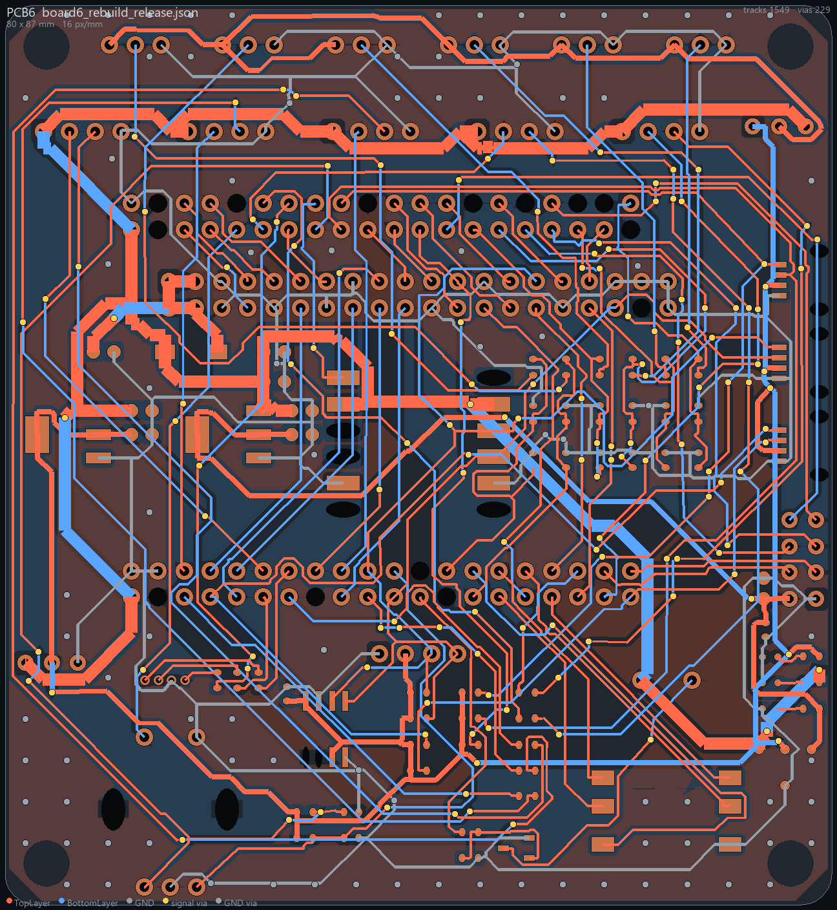

# 示例：电赛小车2026（两块叠板）

全国大学生电子设计竞赛备赛用的小车控制系统，两块 80 × 87 mm 的板子上下叠插：

| 板 | 内容 | 状态 |
|---|---|---|
| 上板（主控、传感） | 2 层；天空星 STM32F407 核心板插座、JY901S IMU、OLED、EC11 旋钮、五向键、6 路灰度、E01 无线、5 路串口、3 路 Qwiic、叠板排针 J603（底面） | **原理图 5 页 + 布局 + 布线 + 铺地完成，DRC 0** |
| 下板（电源、驱动） | 4 层规划；电池输入保护、INA228、电机域开关、两路 DC-DC、DRV8870 电机驱动 ×2、编码器整形、CAN、步进、舵机、叠板排针 J513 | 原理图 6 页完成；PCB 只有板框和孔，**未布局** |

## 结果（上板）

| 指标 | 值 |
|---|---|
| 元件 / 网络 | 90 / 87 |
| DRC | 0 |
| 连通 | 87/87，0 断开 |
| 铜线段 / 过孔 | 1549 / 229（信号 140、地 89） |
| 地面评分 | 94.2（顶层地 38.2%、底层地 60.9%、底层最大整块 3684 mm²、死铜 5 块 12 mm²） |



`reference/board6_rebuild_release.json` 是这块板的完整快照（元件、焊盘、走线、过孔、铺铜），可以直接喂给 `kit/route/conn.py`、`gmetrics.py`、`render.py`。

## 这块板是怎么做出来的（时间线）

1. **需求**（v0.1 → v1.1）：从 8 块旧板分析出问题清单，需求分级，电源架构，板子从 80×80 改为 80×87、四角对称 M3 孔。
2. **引脚**：`inputs/pinmap_sky.py`，62 路信号，0 重脚、0 EXTI 冲突。
3. **原理图**：页面规格 → 建图 → 逐脚核对；首版布局后用 Freerouting 布通（DRC 0）。
4. **地面优化**：评分 16.2 → 53.9（两面铺地、缝合、底层让给地）。
5. **换脚优化（方案 C）**：`inputs/swapopt.py` 把飞线交叉从 871 降到 371，约束是保留下板 J513.37 的 IMON（J603.38 保持不接）。重新布线后过孔 431 → 251。
6. **批量调参**：离线并行 Freerouting 7 轮约 70 版，用户逐轮看前三名选方向，定下 **r9-02** 配方（两层都偏好水平、过孔代价 70、底层代价 3.5/4.5、铜离板边 0.45 mm），评分 89.8。
7. **工作区丢失后重建**（一天）：从会话记录恢复脚本和规格（`kit/recover/`）→ 新工程里重建 11 页原理图（全部 0 problems）→ 按快照复位布局 → r9-02 重布 → 后处理 → 铺地缝合 → DRC 0、评分 94.2。

## 文件

| 路径 | 内容 |
|---|---|
| `board.toml` | 这两块板的真实配置（工程/PCB UUID、尺寸、孔、线宽规则、r9-02 布线参数） |
| `specs/c_u1–5.json`、`c_l1–6.json` | 11 页原理图规格（方案 C，已含用户改过的测试点） |
| `inputs/gen_specC.py` | 由 v2 规格 + 引脚表 + 换脚结果生成上面 11 份规格，并逐脚核对两块板叠板连接器 |
| `inputs/pinmap_sky.py`、`gen_pindoc.py` | 引脚表（单一真源）和引脚文档/固件头文件生成 |
| `inputs/swapopt.py`、`swap_c.json` | 换脚优化模型和定稿结果 |
| `inputs/n*.json`、`p*.json` | v2 页面规格（gen_specC 的输入） |
| `inputs/dumpF.json` | 上板布局快照（`place_from_dump.py` 的输入） |
| `inputs/rules_pcb6_rebuild.json` | 上板设计规则（`kit/pcb/rules.py` 现在可以从 board.toml 直接生成） |
| `reference/` | 成品快照、评分、成品图，方案 C 和批量调参的落地记录 |

## 复现

在你自己的嘉立创EDA 里新建一个工程（两个 Board），把 `board.toml` 和 `inputs/gen_specC.py` 顶部的 UUID 换成你的，然后在本目录下（`board.toml` 所在目录）：

```bash
python inputs/pinmap_sky.py && python inputs/gen_specC.py          # 生成 specs/
python ../../kit/sch/check_specs.py specs/c_u?.json                 # 上板 87 网，RESULT OK
python ../../kit/sch/build_pages.py specs/c_u1.json specs/c_u2.json specs/c_u3.json specs/c_u4.json specs/c_u5.json
python ../../kit/sch/build_pages.py --board lower specs/c_l1.json specs/c_l2.json specs/c_l3.json specs/c_l4.json specs/c_l5.json specs/c_l6.json
easyeda --project <P> --doc <上板PCB> pcb import-changes
python ../../kit/pcb/outline.py
python ../../kit/pcb/rules.py
python ../../kit/pcb/place_from_dump.py inputs/dumpF.json
```

之后按仓库根目录 AGENTS.md 的阶段 5、6 走：导出 DSN → `prep_dsn.py` → `route.py`（4 个版本约 5 分钟）→ `ses_conn.py` → `ses_polish.py --chamfer 0` → `apply_ses.py` → `pour_gnd.py` → `stitch.py` → DRC → 出板。

注意：`inputs/dumpF.json` 是用户改测试点之前的快照（旧编号 TP1/TP2/TP4/TP5）。`specs/c_u2.json` 已换成系统库 Test-Point-0.5mm 并重新编号（TP1 5V_MAIN、TP2 3V3_MAIN、TP3 3V3_RF、TP4 GND）。`place_from_dump.py` 按位号匹配，会把新 TP2、TP4 摆到旧编号（另一个网络）的位置，TP3 不在快照里。复位后再跑一次：

```bash
python ../../kit/pcb/place_table.py inputs/testpoints.csv     # 按网络对应回原坐标
```

## 这块板踩过的坑

见仓库 [docs/07_踩坑清单.md](../../docs/07_踩坑清单.md)。和这块板直接相关的：测试点封装变大导致焊盘重叠；预处理误放大排针焊盘导致 15 条布不通；后处理成股挪断 EC11_B；缝合孔贴排针焊盘。都已经改进到 kit 里。
